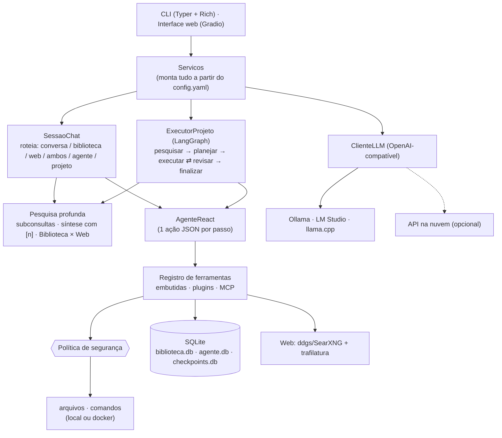
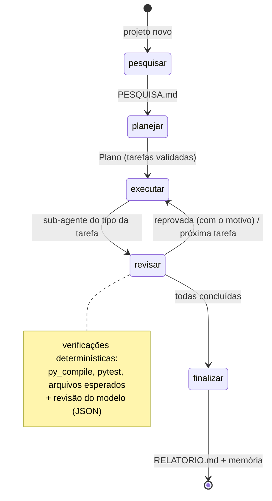

# Arquitetura

## Visão geral

## O fluxo de projeto (LangGraph)

- **Estado**: `objetivo`, `pesquisa`, `tarefas` (id, título, descrição, tipo, critérios, status, tentativas, resultado), `indice`, `status`.
- **Persistência dupla**: o `SqliteSaver` grava o estado a cada nó (thread = id do projeto) **e** o projeto grava arquivos legíveis (`PLANO.md` com `[ ]`, `[~]`, `[x]`, `[!]`; `DIARIO.md` com horário; `.agente/tarefas.json`). `nlr projeto retomar` usa o checkpoint; se ele sumir, reconstrói a partir de `tarefas.json`.
- **Sub-agentes por papel**: `pesquisa` → pesquisador (biblioteca, web, memória); `codigo` → desenvolvedor (arquivos + comandos); `documentacao` → redator; `geral`.
- **Revisor**: primeiro checagens objetivas (compila? testes passam? arquivos dos critérios existem?), depois o modelo dá `aprovada` + motivo. Reprovação volta para o executor com o motivo, até `projetos.max_tentativas_revisao`. Esgotadas as tentativas, a tarefa fica `[!]` e o projeto termina como `com_ressalvas`.
- **Continuar**: `nlr projeto continuar <id> "novo pedido"` abre uma nova *thread* a partir do estado atual e planeja só o que falta.

## Componentes

| Módulo | Responsabilidade |
|---|---|
| `config.py`, `config_modelo.py` | Configuração validada (Pydantic), presets por backend, `.env` para segredos |
| `llm/cliente.py` | Cliente OpenAI-compatível único; `chat`, `chat_json` (JSON validado com novas tentativas e rebaixamento), `chat_ferramentas` (nativo), `embeddings`, *fallback* para nuvem, erros amigáveis |
| `llm/texto.py` | Remove `<think>`, estima tokens, extrai/conserta JSON |
| `biblioteca/` | Carregadores (PDF, DOCX, XLSX, CSV, JSON, HTML, texto, código), fatiamento, índice incremental, busca híbrida + reranker |
| `web/busca.py` | Busca, download e extração de páginas, cache, seleção de trechos |
| `memoria/armazenamento.py` | Sessões, histórico, resumos, lembranças com escopo, extração automática |
| `ferramentas/` | Registro, decorador `@ferramenta`, política de segurança, ferramentas embutidas, cliente MCP |
| `agentes/react.py` | Laço ReAct com orçamento de contexto, resumo de observações antigas, detecção de repetição |
| `agentes/pesquisa.py` | Pesquisa profunda com citações e cruzamento Biblioteca × Web |
| `agentes/chat.py` | Conversa com roteamento automático e memória |
| `agentes/projeto.py`, `projeto_store.py` | Grafo LangGraph do projeto e arquivos do projeto |
| `cli.py`, `ui/web.py` | Interfaces |
| `doctor.py` | Diagnóstico da instalação |

## Gestão de contexto (modelos pequenos)

- `modelo.contexto_tokens` (padrão 8192) define o orçamento. A síntese usa no máximo ~60% dele para fontes; o ReAct resume observações antigas ao passar de 75%; o chat resume o histórico ao passar de 35%.
- Observações de ferramentas são truncadas; o agente pode pedir mais com `ler_arquivo` usando `inicio`/`fim`.

## Por que assim

Ver [PESQUISA.md](PESQUISA.md). Em resumo: LangGraph dá retomada confiável; uma camada de LLM própria e mínima evita incompatibilidades entre servidores locais; SQLite para tudo elimina servidores extras; JSON emulado é o modo mais confiável de ferramentas em modelos de 4–9 B.
